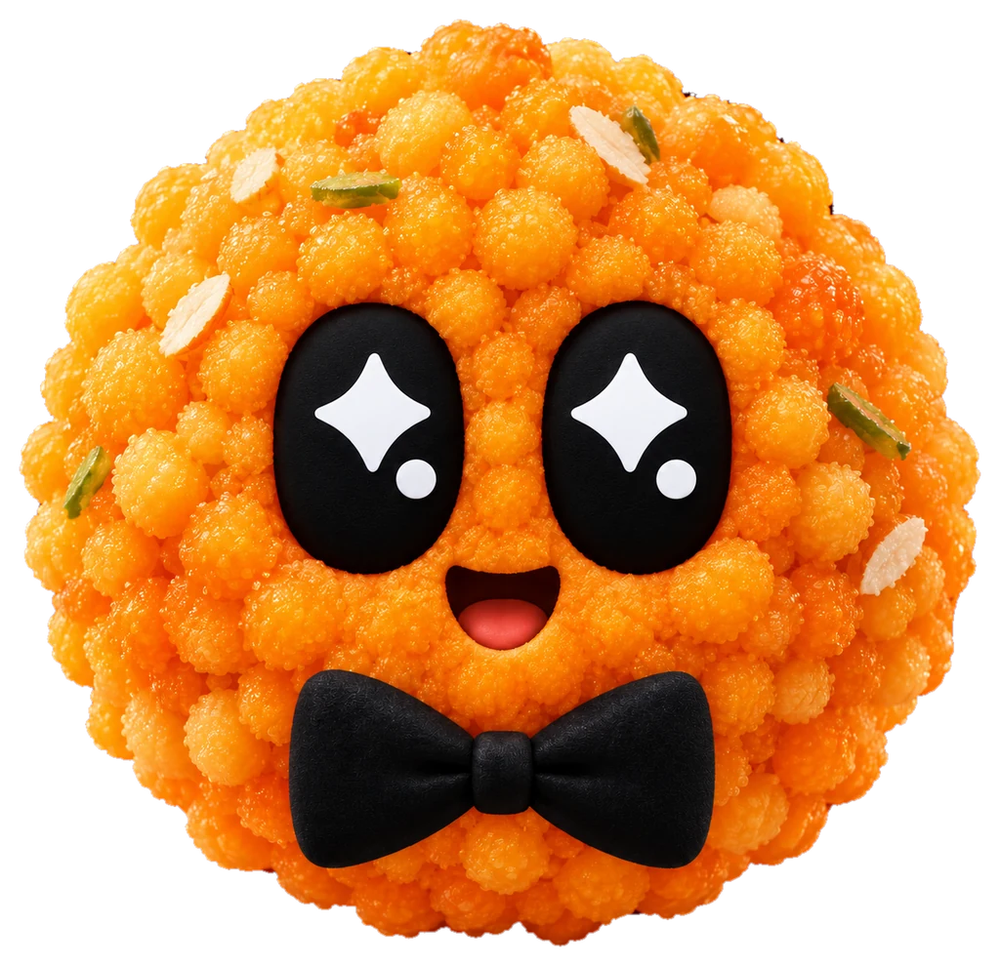

# laddu

Heavily inspired concept from OpenAI dots
VISION is to make a codex/claude like bot which can work in collabrative env
Teams already use slack, so we get comm. interface for free

Formerly dot. Lives at [laddu.wtf](https://laddu.wtf).
